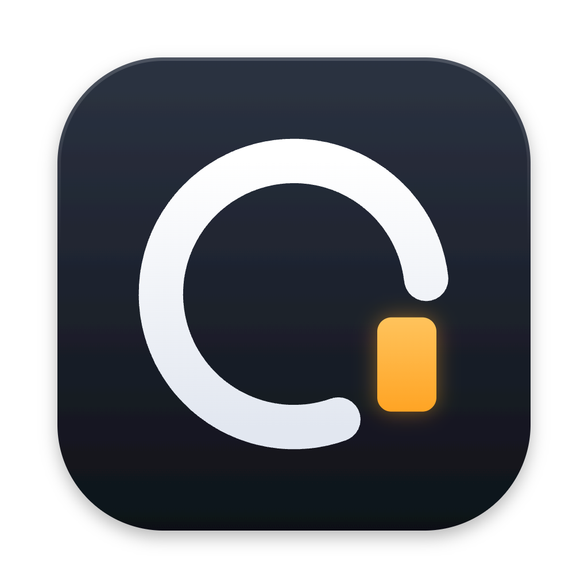

# Own Term

A macOS terminal for working with Claude Code. Keep every session in a sidebar, group them by the
work they belong to, and open a group to see its sessions side by side. Own Term listens to Claude
Code, so you can see at a glance which sessions are working, which need an answer and which are
done, and jump to the next one that needs you.



**Website:** https://own-term.vercel.app

## What it does

- **Sessions and groups.** Click a session to see it alone, click a group to see its sessions side by
  side in the layout you last left them in, ⌘-click sessions from different groups to put them side by
  side and save that as a group. Drag sessions between groups; double-click a divider to make the
  panes equal.
- **Knows what Claude is doing.** Every session shows Working, Needs input, Your turn, Running or
  Exited, in the sidebar and its pane header, and stays Working while Claude's background agents run.
  Sessions that need you collect in Needs You, the Dock badge counts them, and a banner shows
  Claude's last words when one finishes. Needs You keeps them across a restart.
- **Answer without switching.** Reply to a finished session from its banner, its macOS notification
  or the menu bar, and the text goes to Claude as if you'd typed it there.
- **In the menu bar.** From any app, the menu bar icon blinks while Claude works and counts the
  sessions that need you. Its panel shows what each one is doing, and answers permission requests.
- **A browser per session.** With Chrome DevTools MCP, each session's agent drives a Chrome of its
  own, shown live in a window floating over the terminal; click and type in it, resize it, or move
  it out to Chrome. Sign in to
  your sites once and every new session's browser starts signed in.
- **Names things for you.** Claude names a session from your first prompt and a group from its
  sessions, and can put a new session in the group it belongs to. Rename anything by double-clicking.
  Pane headers carry their group's color, and name the group when sessions from several are on screen.
- **Claude's tools.** Claude in a session can see every other session and, when you ask, organize
  the sidebar, start sessions (with a first prompt, or in a new worktree), end them, send a prompt to
  another session and wait for its reply, and set reminders. Each change shows a notice, most with
  Undo.
- **Reminders.** Remind Me puts a time and a note on a session; the sidebar's Later section lists
  them, and when one is due the session joins Needs You.
- **Undo and reopen.** ⌘Z undoes the last few changes to sessions and groups, yours or Claude's, and
  ⇧⌘T reopens a session you ended, resuming its conversation.
- **Picks up where you left off.** After a restart each session reopens in its folder, and a Claude
  session continues the same conversation.
- **Worktrees.** A new session can get its own git worktree and branch; every row shows its branch
  and how many lines changed.
- **A terminal that reads like Warp.** Output fills from the bottom, commands are separated by lines
  (red when they fail), and `file.ts:12` opens in your editor.
- **Mac all the way.** Native menus and dialogs, your accent color, light and dark mode, Reduce Motion.

## Setup

```sh
npm install
npm run install-hooks   # lets Claude Code report its status to Own Term
npm run dev
```

The hooks only do something in a shell Own Term started; elsewhere they exit immediately. Path
completion for `cd` comes from your own zsh setup (zsh-autocomplete and zoxide work well).

## Shortcuts

| Keys | Does |
| --- | --- |
| ⌘P | Command palette: go to any session or group, or run any command |
| ⌘T | New session |
| ⇧⌘T | Reopen the last session you ended |
| ⌘D | Show another session beside this one |
| ⌘J | Go to the session that has waited longest for you |
| ⇧⌘G | Open the latest notification |
| ⌘F, ⌘G | Find in the pane; find next |
| ⌘K | Clear the pane |
| ⌘↩ | Zoom the pane, or double-click its header in a group |
| ⌘W | Close the pane |
| ⌘1 – ⌘9 | Go to a session by its place in the sidebar |
| ⌘Z | Undo the last change to sessions and groups (outside a text field) |
| ⌃⌘S | Hide or show the sidebar |
| ⌃⌘I | Show or hide the info panel |
| ⌘-click | Add a session to what's on screen |
| ⇧↩ | New line in a Claude prompt |

## For contributors

Start with `CLAUDE.md`, then `docs/architecture.md`, `docs/development.md` and `docs/design/README.md`.

| Command | Does |
| --- | --- |
| `npm run dev` | Run the app in development |
| `npm run typecheck` | Type check the app and the site |
| `npm run icon` | Rebuild the icon files from `scripts/icon-art.mjs` |
| `npm run brand` | Rebuild the brand sheet, `docs/design/brand.html` |
| `npm run site` | Run the marketing page on port 5200 |
| `npm run site:deploy` | Build the marketing page and publish it to Vercel |
| `npm run ship` | Publish a new version of what's on GitHub's `master`, through GitHub Actions (`docs/releasing.md`) |
